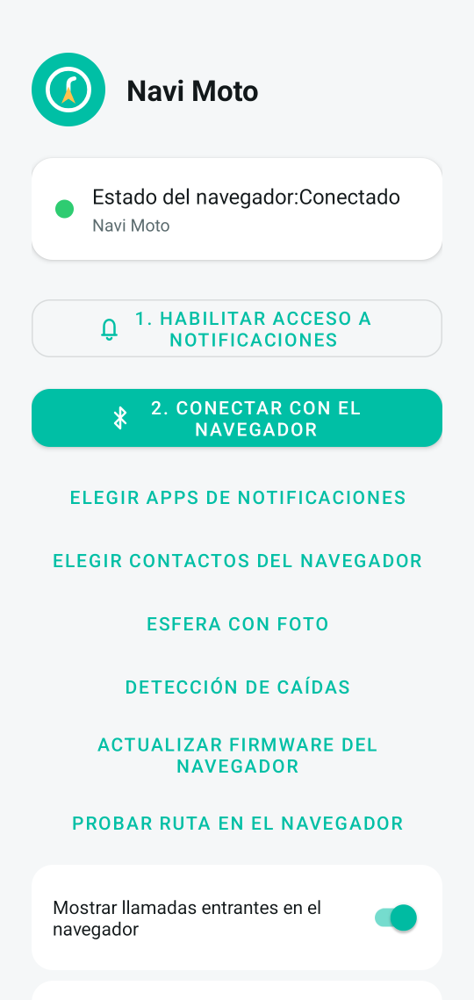
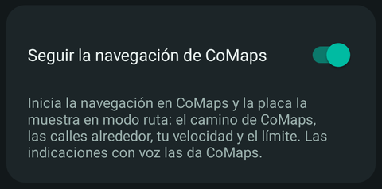
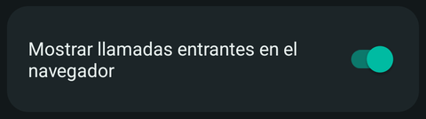
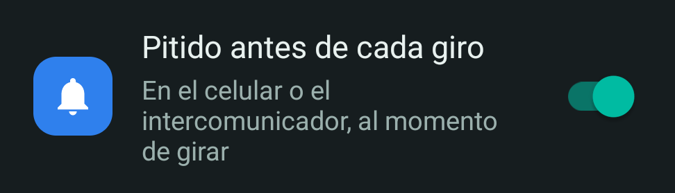
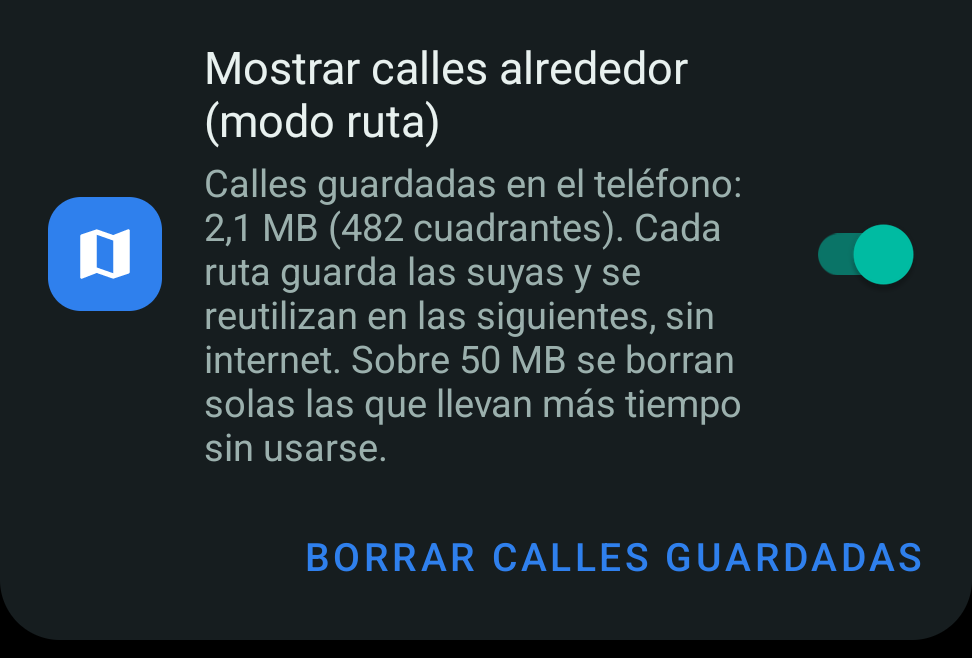
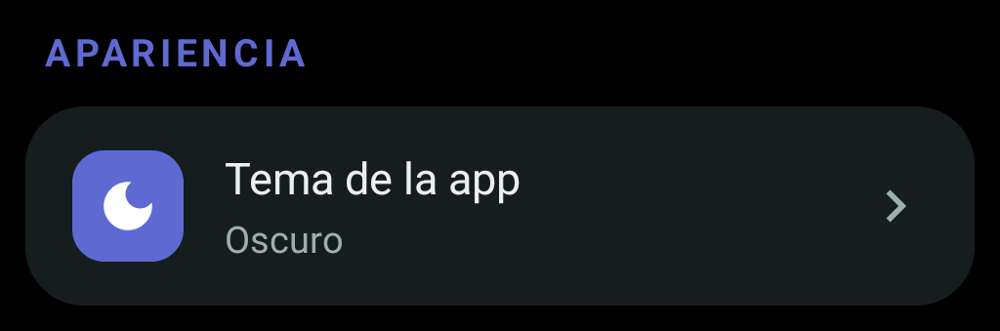
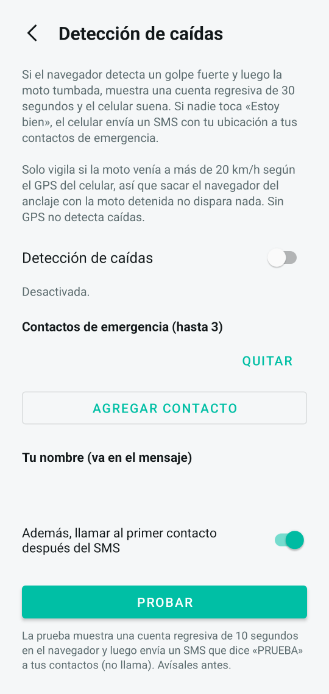

# Manual de uso de Navi Moto

Navi Moto tiene dos partes que trabajan juntas:

- **La placa**: la pantalla redonda que va en el manillar, con este firmware.
- **La app Navi Moto** en el celular Android: calcula las rutas, lee la navegación de Google Maps o CoMaps y le envía todo a la placa por Bluetooth.

La placa sola no navega: siempre necesita la app conectada.

## Lo que necesitas

- La placa Waveshare ESP32-S3 Touch AMOLED 1.75 o 1.75C, con este firmware. Para grabarlo, mira [Compilar y grabar](https://github.com/fvalladaresg1975/navi-moto-firmware#compilar-y-grabar) o los archivos de cada [versión](https://github.com/fvalladaresg1975/navi-moto-firmware/releases).
- La app Navi Moto: descarga el APK de la [última versión de la app](https://github.com/fvalladaresg1975/navi-moto/releases/latest). Necesita Android 8.0 o superior.
- Bluetooth, GPS e internet activados en el celular.
- Para el modo CoMaps: la app [CoMaps](https://comaps.app), versión de agosto de 2026 o más nueva.

## 1. Primera vez: conectar la app con la placa

1. Enciende la placa con el botón **PWR**.
2. Abre la app y toca **1. Habilitar acceso a notificaciones**. Activa *Navi Moto* en la lista y vuelve a la app. Sin este paso no funcionan las notificaciones ni los modos Google Maps y CoMaps.
3. Toca **2. Conectar con el navegador** y acepta los permisos que pida (Bluetooth, ubicación y, si quieres, llamadas y contactos).
4. Cuando la cabecera de colores diga **Conectado** (con el punto verde), ya está. Desde ahí la app se reconecta sola.

Debajo de los botones 1 y 2, las opciones están agrupadas por sección, cada una con su color: **Navegación**, **Llamadas y avisos**, **Seguridad**, **La placa**, **Apariencia** y **Conexión**. Si tienes más de una placa, usa **Cambiar de navegador** en la sección Conexión.

## 2. Los tres modos de navegación

| | Modo ruta | Modo Google Maps | Modo CoMaps |
|---|---|---|---|
| **Cómo se inicia** | Compartes un destino con la app («Ruta al navegador») | Inicias la navegación en Google Maps como siempre | Inicias la navegación en CoMaps como siempre |
| **Quién calcula la ruta** | La app Navi Moto (OpenStreetMap) | Google Maps | CoMaps (OpenStreetMap) |
| **Qué muestra la placa** | El camino dibujado con las calles alrededor, como un mapa | Una flecha grande con la indicación escrita | El camino de CoMaps dibujado con las calles alrededor, como en el modo ruta |
| **Quién da la voz** | La app Navi Moto | Google Maps | CoMaps |
| **Opciones** | Evitar autopistas, evitar peajes | Las de Google Maps | Las de CoMaps |
| **Necesita** | GPS e internet al calcular | Acceso a notificaciones (paso 2 de arriba) | Acceso a notificaciones y el interruptor **Seguir la navegación de CoMaps** |

En los tres modos la placa muestra tu velocidad y el límite de la vía, que se pone en rojo si lo pasas.

## 3. Modo ruta

### Iniciar una ruta

1. Busca el destino en **Google Maps** o en **CoMaps**.
2. Toca **Compartir** y elige **Ruta al navegador**.
3. La app busca tu ubicación y calcula la ruta. Aquí puedes marcar **Evitar autopistas** y **Evitar peajes (TAG)**, y lees un resumen con la distancia, el tiempo y el primer giro.
4. Toca **Iniciar en el navegador**. La placa abre la navegación sola (mira la sección 6).

Desde **CoMaps** el destino llega con coordenadas exactas. Desde **Google Maps**, a veces la app tiene que buscar el lugar por su nombre: revisa que el destino que muestra sea el correcto.

### Qué ves en la placa

- **Caja azul**: la flecha del próximo giro y cuántos metros faltan.
- **Línea blanca**: el camino que tienes por delante, sobre las calles de la zona.
- **Número a la izquierda**: tu velocidad. Se pone roja si pasas el límite.
- **Círculo rojo**: el límite de velocidad de la vía.
- **Abajo**: la distancia que falta hasta el destino.
- **Anillo naranja**: cuánto falta para el próximo giro.
- **Zoom automático**: cerca en ciudad y más lejos en carretera.

El celular da las indicaciones con voz y con un pitido antes de cada giro (el pitido se apaga en la app). Si te sales del camino, la app recalcula la ruta sola.

### Terminar la ruta

Cualquiera de estas tres:
- En la placa, **desliza hacia la izquierda** y toca **Salir**.
- En la app, toca **Detener ruta en el navegador**.
- En el widget de la pantalla de inicio, toca **Detener ruta**.

### Probar sin salir

En la app toca **Probar ruta en el navegador**: la placa recorre una ruta inventada, primero en modo ruta y después con la flecha. Sirve para conocer las pantallas antes de salir, y no se guarda como viaje.

## 4. Modo Google Maps

1. Revisa que la app tenga **acceso a notificaciones** (paso 2 de la primera vez) y que Google Maps tenga sus notificaciones activadas en Android.
2. Con la placa conectada, abre **Google Maps**, elige el destino y toca **Iniciar**.
3. La placa abre la navegación sola.

### Qué ves en la placa

- **Arriba al centro**: la flecha de la próxima maniobra, la misma que dibuja Google Maps.
- **Número a la izquierda**: tu velocidad (del GPS del celular). Se pone roja si pasas el límite.
- **Círculo rojo**: el límite de velocidad de la vía, cuando se conoce.
- **Al centro**: los metros hasta la maniobra y la indicación escrita («En la rotonda, toma la segunda salida»).
- **Abajo**: tiempo que falta · distancia que falta · hora de llegada.
- **Anillo naranja**: cuánto falta para la maniobra; se llena a medida que te acercas.

Para terminar, sal de la navegación en Google Maps, o en la placa **desliza hacia la izquierda** y toca **Salir**: la app cierra la navegación de Google Maps en el celular.

## 5. Modo CoMaps

La navegación de **CoMaps** se ve en la placa igual que el modo ruta: el camino que calculó CoMaps dibujado sobre las calles de la zona, la flecha y la distancia del próximo giro, tu velocidad y el límite de la vía.

### Activarlo (una sola vez)

1. Instala o actualiza **CoMaps** (versión de agosto de 2026 o más nueva).
2. En la app Navi Moto activa **Seguir la navegación de CoMaps** y acepta el permiso de CoMaps que pide Android.

### Navegar

1. Con la placa conectada, abre **CoMaps**, elige el destino y toca **Iniciar**.
2. La placa abre la navegación sola. Las indicaciones con voz las da CoMaps; el pitido antes de cada giro sigue funcionando (se apaga en la app).
3. Si te sales del camino, CoMaps recalcula la ruta y la placa toma la nueva.

### Terminar

- **Detén la navegación en CoMaps**: la placa la cierra al instante.
- En la placa, **desliza hacia la izquierda** y toca **Salir**: se cierra la navegación en la placa, pero **CoMaps sigue navegando en el celular**, porque CoMaps no deja que otra app la detenga. La próxima navegación que inicies en CoMaps se abre sola en la placa.

## 6. La placa durante la navegación

| Gesto | Qué hace |
|---|---|
| Deslizar hacia abajo | Panel de música, volumen y baterías. Deslizando hacia arriba vuelves a la navegación. |
| Deslizar hacia la izquierda | Botón **Salir** para terminar la navegación. Deslizando hacia la derecha se cierra sin salir. |
| Deslizar hacia la derecha | Sale a la lista de apps sin terminar la navegación. |

Con **Iniciar navegación automática** activado en los **Ajustes** de la placa (viene así), la navegación se abre sola al empezar, y si te vas a otra pantalla la placa **vuelve sola a la navegación** después de 15 segundos sin tocarla, para que no tengas que buscarla en marcha.

## 7. Moverse por la placa

Desde la esfera (la pantalla con la hora):

| Gesto | Qué abre |
|---|---|
| Deslizar hacia abajo | Panel de control: música, volumen y batería de la placa y del celular |
| Deslizar hacia arriba | Clima |
| Deslizar hacia la izquierda | Lista de apps |
| Deslizar hacia la derecha | Notificaciones |
| Mantener presionado | Elegir otra esfera |

### Esferas

La esfera es la pantalla con la hora. Para cambiarla, **mantén presionada** la esfera y elige otra. Todas muestran la hora del celular y se actualizan solas con el clima que envía la app.

**Pixel Moto** — la hora grande con la fecha y, debajo, cuatro datos: temperatura, viento, batería de la placa y batería del celular (con un rayo si están cargando). Arriba, la moto con un punto verde cuando la placa está conectada al celular. Abajo, el último viaje (distancia y duración).

**Tablero** — la hora como un tacómetro: la aguja marca la hora en una escala de 0 a 12. **BT** en verde = conectada al celular. La barra **E–F** es la batería de la placa, como un medidor de bencina. Al lado, la temperatura y el clima; abajo, **TRIP** con la distancia del último viaje.

**Clima de ruta** — para decidir si salir: la temperatura de ahora y las próximas 5 horas, cada una con su probabilidad de lluvia. Debajo, un resumen («Sin lluvia en 5 horas» o «Lluvia desde las 16 h»), el viento y la hora del atardecer. Los arcos del borde son las baterías, a la izquierda la placa y a la derecha el celular: se llenan con la carga y son verdes, naranjos bajo 50 % y rojos bajo 20 % (azules mientras cargan).

**Copiloto** — la hora gigante y en alto contraste, para leerla de un vistazo en marcha. Abajo, si está conectada al celular y la temperatura. Los arcos del borde son las baterías, como en Clima de ruta.

**Foto** — una foto tuya de fondo con la hora encima. Se elige y se ajusta en la app (mira la [sección 9](#9-otras-funciones)).

### Panel de control (deslizar hacia abajo)

- **Arriba**: batería de la placa y del celular, en porcentaje. Los arcos del borde muestran lo mismo: la placa a la izquierda, el celular a la derecha.
- **Botones del centro**: canción anterior, reproducir / pausa y canción siguiente de la música del celular.
- **Botones de abajo**: bajar y subir el volumen del celular.
- **Ícono de Bluetooth**: en color cuando la placa está conectada al celular.

Desliza hacia arriba (o toca la flecha de abajo) para volver. Durante la navegación, este panel se abre igual deslizando hacia abajo.

### Clima (deslizar hacia arriba)

El clima de tu ubicación: ícono, temperatura y la hora en que la app lo actualizó. La app lo envía al conectarse y cada 30 minutos.

## 8. Ajustes de la app

Estos interruptores están en la pantalla principal de la app: los de navegación en la sección **Navegación** y el de llamadas en **Llamadas y avisos**. Quedan guardados: basta con activarlos una vez.

### Mostrar llamadas entrantes en el navegador

Cuando entra una llamada, la placa muestra **Llamada entrante** y quién llama (con su nombre si está en tus contactos). Toca el botón **verde** para contestar o el **rojo** para rechazarla; la conversación sigue por el celular o por el intercomunicador del casco. Al activarlo, Android pide los permisos de teléfono, registro de llamadas y contactos; si no los das todos, el interruptor se vuelve a apagar.

Con **Elegir contactos del navegador** escoges hasta 20 contactos que aparecen en la placa: si tocas uno, el celular lo llama.

### Seguir la navegación de CoMaps

Muestra en la placa la navegación que inicias en CoMaps. Al activarlo, Android pide el permiso de CoMaps. Cómo se usa: [sección 5](#5-modo-comaps).

### Pitido antes de cada giro

Un pitido corto en el momento de girar, unos 2 segundos antes de la esquina, después de la indicación con voz. Al llegar al destino suena un pitido doble. Suena en el celular o en el intercomunicador Bluetooth del casco, igual que la voz (la placa no tiene parlante). Funciona en los tres modos.

### Mostrar calles alrededor (modo ruta)

Dibuja tenues las calles de la zona bajo el camino, en el modo ruta y en el modo CoMaps. Se descargan de OpenStreetMap al empezar la ruta y quedan guardadas en el celular, así que otra ruta por la misma zona las usa sin internet. Sobre 50 MB se borran solas las que llevan más tiempo sin usarse; **Borrar calles guardadas** las borra todas. Apagado, la placa muestra solo el camino.

El **pitido** y las **calles** también se cambian desde el widget de Navi Moto en la pantalla de inicio de Android.

### Tema de la app

En la sección **Apariencia**, **Tema de la app** elige entre **Igual que el teléfono** (lo normal), **Claro** u **Oscuro**. El oscuro usa fondo negro puro: en teléfonos con pantalla OLED o AMOLED esos píxeles quedan apagados y gasta menos batería; en pantallas LCD el ahorro es casi nulo. La placa no cambia, siempre usa fondo negro.

## 9. Otras funciones

### Detección de caídas

 

**Activarla**: en la app, **Detección de caídas**. Agrega hasta 3 contactos de emergencia y activa el interruptor. El botón **Probar** envía de verdad un SMS que dice «PRUEBA»: avísales antes a tus contactos.

**Cómo funciona**: el sensor de la placa busca un golpe fuerte seguido de la moto tumbada, y solo cuenta si venías a más de 20 km/h según el GPS del celular (sacar la placa del anclaje estacionado no la dispara). Entonces la placa se pone roja y cuenta 30 segundos:

- Si estás bien, toca **Estoy bien** y no pasa nada.
- Si nadie lo toca, el celular envía a tus contactos un SMS con tu ubicación.

### Batería baja de la placa

- Al **15 %** la placa muestra un aviso.
- Al **5 %** se pone naranja y cuenta 30 segundos para apagarse. Toca **Seguir encendida** si la necesitas un rato más.
- Durante la navegación solo muestra avisos pequeños y sigue encendida hasta que la batería está casi vacía; si hay una posible caída en curso, esa siempre tiene prioridad.
- Para volver a encenderla, presiona **PWR** (mejor con el cargador conectado).

### Más funciones

- **Actualizar el firmware sin cable**: en la app, **Actualizar firmware del navegador**, elige el `.bin` de tu placa (1.75 o 1.75C) desde la [página de versiones](https://github.com/fvalladaresg1975/navi-moto-firmware/releases) y toca **Actualizar el navegador**. Si el firmware nuevo falla, la placa vuelve sola a la versión anterior.
- **Esfera con foto**: en la app, **Esfera con foto**. Elige una foto, ajústala en el círculo y envíala; luego, en la placa, mantén presionada la esfera y elige **Foto**.
- **Notificaciones**: en la app, **Elegir apps de notificaciones** decide qué apps llegan a la placa. Las llamadas se explican en la [sección 8](#8-ajustes-de-la-app).

## Problemas frecuentes

| Qué pasa | Qué hacer |
|---|---|
| La app dice «No encontré un destino» o «No pude obtener la ubicación del lugar de Google Maps» | Comparte el destino desde CoMaps, que envía coordenadas exactas. |
| La app pide **ubicación precisa** | En Android: Ajustes → Apps → Navi Moto → Ubicación → Usar ubicación precisa. |
| «No pude conectar con el servidor de rutas» | Revisa la conexión a internet del celular y vuelve a compartir el destino. |
| Con Google Maps la placa no muestra nada | Revisa el acceso a notificaciones de la app (botón 1) y que Google Maps tenga las notificaciones activadas. |
| Con CoMaps la placa no muestra nada | Revisa que **Seguir la navegación de CoMaps** esté activado en la app, el acceso a notificaciones (botón 1) y que CoMaps esté actualizado. |
| «No se pudo salir de la navegación» | No hay una navegación activa en Google Maps; si estabas en modo ruta, deténla desde la app. |
| La app dice **Detenido** o la placa no se conecta | Revisa que la placa esté encendida y el Bluetooth activado, y toca **2. Conectar con el navegador**. |
